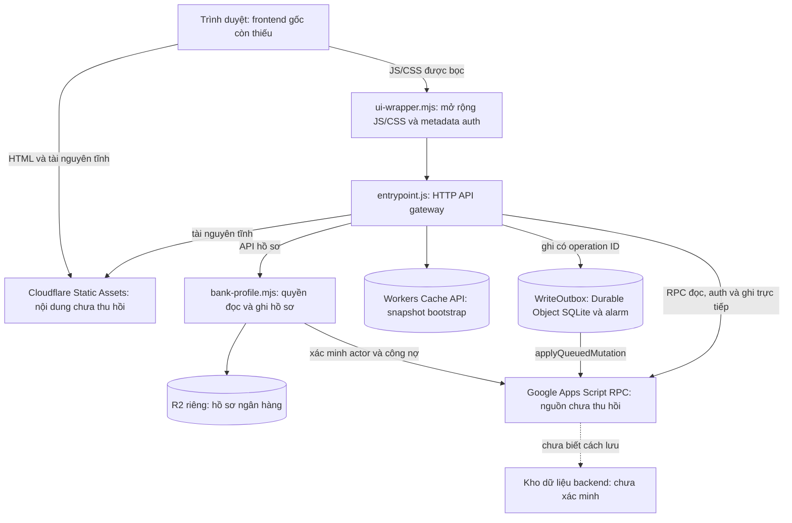

# Kiến trúc RPA Money theo bằng chứng khôi phục

## Phạm vi bằng chứng

Tài liệu dựa trên ba module tải trực tiếp bằng Cloudflare API ngày 25/10/2026 và cấu hình runtime đọc trong cùng phiên. Route của hostname ứng dụng được đối chiếu với Worker đang phục vụ; deployment được kiểm tra trước và sau khi tải. Toàn bộ thao tác Cloudflare là đọc; không deploy, đổi route, binding, secret hoặc cấu hình production.

Các file trong `recovered/worker/` là **mã đầu ra đã triển khai**, không phải bộ nguồn gốc. `entrypoint.js` còn comment đánh dấu các phần `src/...`; chúng không cung cấp lại cây module hoặc source map. Mười file trong `recovered/frontend-extensions/` là các chuỗi JS/CSS được giải mã từ wrapper, không phải các file nguồn trước build.

API đọc trả ba module, handler `fetch` và lớp `WriteOutbox`. Đồ thị import cho thấy `ui-wrapper.mjs` bọc `entrypoint.js`; bản trả về đã dùng không có trường xác nhận `main_module`. Vì vậy vai trò lớp ngoài được suy ra từ mã và cấu hình route assets, không được trình bày như metadata entrypoint đã thu hồi.

## Sơ đồ thành phần

Không có bằng chứng module phục hồi sử dụng D1, KV hoặc một database SQL bên ngoài cho sổ chi tiêu. SQLite được xác nhận trong `WriteOutbox` để điều phối ghi; đây không phải bằng chứng rằng toàn bộ sổ chi tiêu nằm trong Durable Object.

## Trình duyệt và wrapper giao diện

[ui-wrapper.mjs](../recovered/worker/ui-wrapper.mjs) chuyển request thông thường sang gateway. Với `GET /js/app.js` và `GET /css/app.css`, nó lấy asset gốc từ `ASSETS` qua gateway, rồi bổ sung mã. Cấu hình đọc được đặt Worker chạy trước cho `/api`, `/api/*` và hai đường dẫn JS/CSS này; các Static Assets khác có thể được phục vụ trực tiếp.

CSS được nối thêm layout, giao diện công nợ và QR. JS chỉ được sửa khi mỗi marker HTML dự kiến xuất hiện đúng một lần; nó thay layout chi tiết người tham gia và tổng tiền, rồi chèn các phần mở rộng trước `init();` cuối file. Nếu marker không khớp, wrapper trả asset gốc. Nếu asset gốc không có, wrapper không tự tạo lại frontend.

Các phần nhúng được giải mã gồm:

| File | Vai trò được thấy trong mã |
| --- | --- |
| `bank-qr.bundle.js` | Tạo/đọc QR trên thiết bị, form hồ sơ, modal và chia sẻ/tải ảnh; bundle còn minify |
| `bank-qr-host.js` | Nối tính năng QR với session, khoảng ngày và API cùng origin |
| `bank-qr.css`, `layout.css`, `obligations.css` | CSS bổ sung cho asset gốc |
| `obligations.js` | Tính nhóm cần trả/cần nhận và render phần công nợ |
| `report-date.js` | Trạng thái bộ lọc ngày riêng cho các tab |
| `calendar-mode.js` | Chuyển nhãn lịch dương/âm theo ngày dân sự; bảng năm âm 1976–2050 |
| `local-preferences.js` | Lựa chọn hiển thị lưu cục bộ trong trình duyệt |
| `presentation-labels.js` | Nhãn/trạng thái hiển thị theo các điểm ghép của wrapper |

Các file phụ thuộc vào globals của frontend gốc như `D`, `render`, `tab`, `range` và `init`. Không có HTML hoặc implementation các globals đó trong export. Nhãn `QR_CONFORMANCE` trong bundle là chuỗi tự mô tả của mã, không phải chứng nhận độc lập từ lần khôi phục này.

## Gateway, session và RPC

[entrypoint.js](../recovered/worker/entrypoint.js) định tuyến `/api` và chuyển phần còn lại tới `env.ASSETS.fetch`. Các nhóm endpoint được nhìn thấy trực tiếp:

| Nhóm | Endpoint tiêu biểu |
| --- | --- |
| Khởi tạo/đọc | `GET /api/public`, `/api/me`, `/api/data`, `/api/bootstrap`, `/api/csrf` |
| Xác thực | login, register, logout, password; Google OAuth start/callback |
| Quản trị | kích hoạt user, tạo user tạm, preview/gán user tạm, cấu hình Google OAuth |
| Chi tiêu | `POST /api/notes`, `PUT/DELETE /api/notes/:id` |
| Thanh toán ghi nhận | `PATCH /api/notes/:id/payments/:userId`, `POST /api/payments/batches` |
| Đồng bộ ghi | `GET /api/operations`, `/api/operations/:id` |
| Hồ sơ QR | `GET/PUT /api/bank-profile`, `GET /api/users/:id/bank-profile` |

Session token nằm trong cookie `__Host-rpa_session` với `Secure`, `HttpOnly`, `SameSite=Lax`. Gateway kiểm tra định dạng token; authority về tài khoản/session vẫn thuộc RPC GAS. Mutation kiểm tra Origin, JSON Content-Type và `X-CSRF-Token`, ký HMAC gắn với seed cookie và session. Các limiter API/auth được yêu cầu trong môi trường staging/production.

`callGas` gửi POST tới URL HTTPS của Apps Script Web App được cung cấp qua secret binding. Payload chứa `{action, params, token}`; envelope có version, requestId, timestamp, nonce, payload và chữ ký HMAC-SHA256. Mã kiểm soát timeout, kích thước request/response, requestId và redirect Content Service sang `script.googleusercontent.com/macros/echo`. Đây là hợp đồng phía client; chưa xác minh được implementation kiểm tra chữ ký/replay hoặc nghiệp vụ phía Apps Script.

Wrapper bổ sung cookie metadata `__Host-rpa_auth_method`, ký HMAC theo phương thức password/oidc và session, rồi đưa `authMethod` vào response đọc phù hợp. Metadata này phục vụ hiển thị; quyền đăng nhập hoặc phân quyền không được xác định từ nó.

## Bootstrap và cache

Gateway tạo khóa cache HMAC từ origin, URL GAS và session token, không đưa token thô vào URL cache. Snapshot cache có TTL 15 giây và giới hạn kích thước. Mỗi bootstrap vẫn gọi GAS, có thể truyền `knownVersion`; chỉ dùng snapshot cũ khi upstream trả unchanged và thông tin user khớp. Vai trò, trạng thái active và dấu vân tay user được đối chiếu trước khi dùng lại cache.

Đây là Cache API ở Worker, không phải cam kết đồng bộ cache toàn cầu hay cơ chế thay thế kiểm tra quyền ở backend.

## Ghi và đối soát bằng Durable Object

Mutation có `X-RPA-Operation-Id` được chuyển vào `WRITE_OUTBOX`; khi không có header, các route ghi tương ứng gọi GAS trực tiếp. Header phải là operation UUID hợp lệ. Durable Object được chọn theo tên ledger gắn với URL backend.

`WriteOutbox` dùng SQLite với bảng `leases` và `operations`. Lease gắn session đã HMAC với actor được xác minh mới qua GAS. Mã lưu digest ổn định của action/params, kiểm tra operation ID trùng nhưng nội dung khác, mã hóa session token bằng AES-GCM và chạy xử lý qua alarm.

Luồng trạng thái gồm `pending → processing → confirmed`; lỗi có thể chuyển `failed` hoặc `uncertain`. Trạng thái uncertain được đối soát lại bằng cùng ID qua RPC `applyQueuedMutation`; một số tình huống cần người dùng review thay vì tự ghi thay thế. Dữ liệu terminal được dọn theo thời hạn trong mã. Không thể kết luận đảm bảo exactly-once đầu cuối khi chưa có implementation idempotency và lưu trữ phía GAS.

## Hồ sơ ngân hàng và QR

[bank-profile.mjs](../recovered/worker/bank-profile.mjs) kiểm tra actor active, không phải user tạm/đã gán và `X-RPA-Actor` khớp session. Lưu hồ sơ yêu cầu expectedRevision, rồi ghi R2 có điều kiện ETag/If-None-Match để phát hiện xung đột.

Mỗi UUID có một object `rpa_qr/<uuid>.json`; record có schemaVersion, appScope, ownerId, username, bankBin, accountNumber, revision và updatedAt. Đây là mô tả schema từ mã; không có object thực được đọc hoặc xuất. Phần công khai giữ tên field và danh mục BIN công khai, không chứa thông tin tài khoản thật.

Actor được đọc hồ sơ của mình. Muốn đọc hồ sơ chủ nợ phải có khoản cần trả còn chưa thanh toán trong dữ liệu được GAS cấp quyền, đúng bộ lọc ngày/scope. Mã chọn revision mới nhất, kiểm tra xung đột cùng revision, bỏ khoản đã xóa và dùng BigInt cộng số tiền; API trả `debtAmount` dưới dạng chuỗi. Trình duyệt lấy số tiền mới và kiểm tra nó khớp nhóm công nợ trước khi tạo QR thanh toán.

QR thiết lập là QR tái sử dụng, không chứa số tiền. QR thanh toán dùng số tiền đã lọc. Import ảnh, đọc QR và tạo ảnh được thực hiện ở trình duyệt; có giới hạn loại/kích thước ảnh và kiểm tra CRC. Tên tài khoản không được coi là đã xác minh; dịch vụ trả `nameVerified: false`. Các endpoint payment ghi nhận trạng thái thanh toán trong ứng dụng; mã khôi phục không chứng minh có chuyển tiền trực tiếp qua ngân hàng.

## Binding và ranh giới riêng tư

| Binding | Chức năng |
| --- | --- |
| `ASSETS` | Static Assets gốc còn thiếu |
| `APP_ORIGIN`, `ENVIRONMENT` | Origin chuẩn và lựa chọn chính sách môi trường |
| `GAS_API_URL`, `GAS_API_SECRET`, `SESSION_SECRET` | Secret bindings; chỉ biết tên, không đọc được giá trị qua metadata |
| `API_RATE_LIMITER`, `AUTH_RATE_LIMITER` | Giới hạn request API và xác thực |
| `WRITE_OUTBOX` | Namespace Durable Object chứa lớp `WriteOutbox` |
| `BANK_PROFILES`, `BANK_PROFILE_SCOPE` | Bucket R2 riêng và scope hồ sơ |

Không công khai account/zone/namespace ID, tên bucket thực, metadata tác giả triển khai hoặc giá trị biến môi trường. Scope riêng hardcode duy nhất trong module R2 được thay bằng `example-bank-profile-scope-v1`; binding của một môi trường mới phải khớp scope đã chọn. Việc thay scope không phải quy trình migration cho dữ liệu production.

## Build, kiểm thử và giới hạn khôi phục

Không có dependency lock, build config hoặc nguồn Apps Script gốc. `package.json`, script giải mã và test trong repo được viết mới để kiểm tra export. `npm run check` đối chiếu SHA-256, kiểm tra cú pháp, tính nhất quán của file giải mã và dò mẫu giá trị nhạy cảm; việc dò mẫu không thay thế rà soát thủ công. `npm test` kiểm tra hành vi tiêu biểu với dữ liệu giả và import shim cho `cloudflare:workers`.

Các kiểm tra này không xác nhận runtime SQLite/alarm, tích hợp Google OAuth, native sharing, trình duyệt thực hoặc nghiệp vụ GAS đầu cuối. Không có kiểm thử production và không có workflow deploy.

Để build lại ứng dụng đầy đủ cần lấy riêng frontend Static Assets gốc cùng bộ nguồn/build tương ứng, Apps Script cùng manifest và hợp đồng dữ liệu thực; sau đó dựng cấu hình tài nguyên mới và kiểm thử tích hợp trong môi trường riêng. Không thể tạo đúng bản production chỉ từ các file hiện có. Xem [ghi chép khôi phục](RECOVERY.md) và [manifest](../recovery-manifest.json) để biết inventory và biến đổi công khai.
