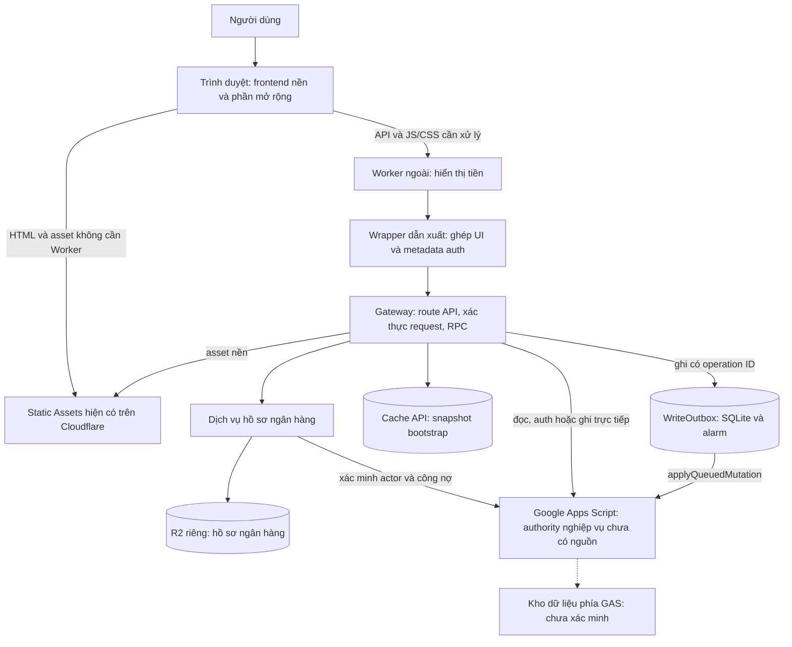
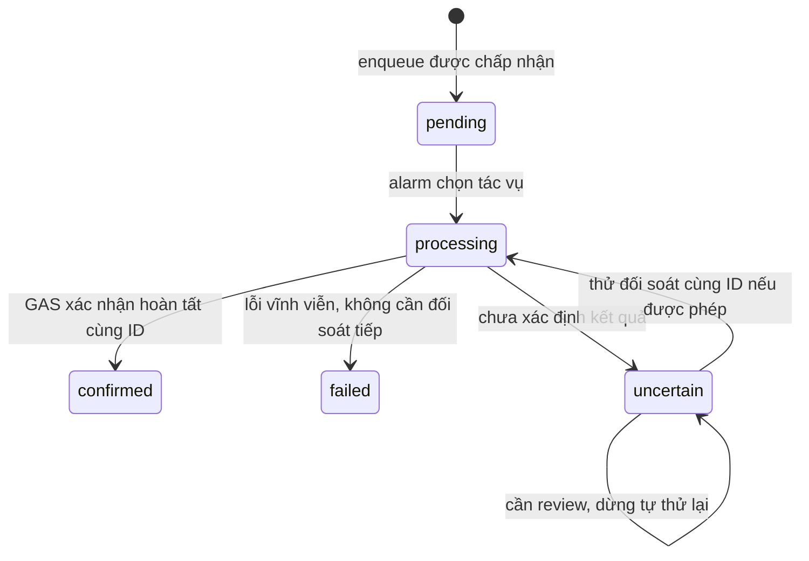

# Kiến trúc ứng dụng ghi chú chi tiêu RPA Money

Trạng thái: tổng quan hệ thống hiện hành, viết lại ngày 25/10/2026 và đối chiếu qua EGM Review. Đây không phải đặc tả đủ để tái triển khai ứng dụng chỉ từ tài liệu. Các việc đề xuất ở cuối chưa được triển khai; phạm vi và giới hạn review được lưu tại [báo cáo tổng hợp](reviews/architecture-2026-10-25/consolidated_review_report.md).

## 1. Mục đích và phạm vi

Ứng dụng ghi lại khoản chi, người trả trước và phần phân bổ cho từng người; từ đó hiển thị khoản cần trả, cần thu và trạng thái thanh toán. Người dùng có thể lưu hồ sơ ngân hàng và tạo QR để chuyển khoản bằng ứng dụng ngân hàng của họ. Các endpoint payment ghi nhận trạng thái trong sổ chi tiêu; mã đã thu hồi không chứng minh có chức năng tự chuyển tiền qua ngân hàng.

Các tab dùng chung session và dữ liệu được backend cấp quyền. Bộ lọc ngày/phạm vi và lựa chọn cách hiển thị là trạng thái giao diện. Tên user, hồ sơ ngân hàng, ghi chú và chi tiết tài chính thật không nằm trong tài liệu hoặc fixture của repo.

### Thuật ngữ dùng trong tài liệu

| Thuật ngữ | Nghĩa trong hệ thống này |
| --- | --- |
| GAS / RPC | Google Apps Script / lời gọi hàm từ xa từ Worker tới GAS |
| Actor | Tài khoản đang thực hiện yêu cầu, được server xác minh |
| Wrapper | Lớp ghép phần mở rộng vào frontend nền và chuyển tiếp request |
| Durable Object (DO) | Đối tượng có định danh và bộ nhớ bền vững do Cloudflare quản lý; ở đây dùng cho hàng đợi ghi |
| Lease | Quyền nhận ghi có thời hạn gắn session và actor; không phải lệnh hủy operation |
| Scope bộ lọc | Phạm vi công nợ: all, me hoặc ID người dùng; truyền qua tham số scope |
| Scope lưu hồ sơ | BANK_PROFILE_SCOPE và record.appScope kiểm tra phạm vi lưu hồ sơ của ứng dụng; không phải scope bộ lọc |
| Exactly-once | Mỗi tác vụ chỉ được áp dụng một lần; chưa có bằng chứng xác nhận đầu cuối |
| Kế thừa strict | Upload phải dừng nếu binding cần kế thừa không được tìm thấy |
| RTO / RPO / SLO | Mục tiêu thời gian khôi phục / mức mất dữ liệu cho phép / mục tiêu mức dịch vụ |

## 2. Bằng chứng và phần chưa biết

| Thành phần | Bằng chứng có thể kiểm tra | Giới hạn |
| --- | --- | --- |
| Mã UI mới | [src/worker.mjs](../src/worker.mjs), [src/ui/](../src/ui/) | Cần frontend nền và wrapper để chạy |
| Gateway và hồ sơ ngân hàng | [recovered/worker/](../recovered/worker/) | Bundle triển khai, không phải module nguồn trước build |
| Các phần frontend bổ sung | [recovered/frontend-extensions/](../recovered/frontend-extensions/) | Giải mã từ chuỗi nhúng; QR bundle còn minify |
| Static Assets | Binding và cấu hình Cloudflare; [biên bản deploy](DEPLOYMENT.md) | HTML, app.js, app.css nền chưa có trong repo |
| Google Apps Script | Hợp đồng gọi RPC trong gateway | Chưa có project, manifest, schema hoặc implementation phía GAS |
| Phiên bản phục vụ | Cloudflare Deployments API đối chiếu lại ngày 25/10/2026 | Không thay thế kiểm tra website qua trình duyệt |

Production được xác nhận chạy bản UI và QR prefetch triển khai lúc 12:45:26 UTC, lấy thay đổi từ commit `8c69077f1c45d3da6c79d29609d00adf2a15840c`. Deployment được kiểm tra lại trong lần viết tài liệu này, vẫn phục vụ 100% traffic. Đường dẫn vào mới được xác nhận khi upload là `money-layout-worker.mjs`; khác với suy luận entrypoint ở bản khôi phục ban đầu.

Không có bằng chứng xác nhận sổ chi tiêu lưu trong Google Sheets, D1, KV hoặc một database cụ thể khác. SQLite được thấy trong Durable Object chỉ chứng minh nơi lưu hàng đợi ghi. Không suy ra schema backend từ tên action RPC.

## 3. Các thành phần và ranh giới

Cloudflare chạy Worker trước cho `/api`, `/api/*`, `/js/app.js`, `/css/app.css`; các asset phù hợp còn lại có thể được phục vụ trực tiếp. Mã Worker ngoài chuyển request vào wrapper/gateway, rồi nối phần hiển thị tiền vào response JS/CSS thành công. Nó không thay đổi payload nghiệp vụ của API.

GAS xác nhận session và xử lý nghiệp vụ qua RPC. `X-RPA-Actor` là điều kiện đối chiếu với actor do server xác minh, không phải nguồn xác định danh tính. R2 giữ hồ sơ ngân hàng riêng; frontend chỉ nhận hồ sơ qua API kiểm tra quyền.

## 4. Mô hình dữ liệu nhìn thấy từ mã

| Khái niệm | Trường hoặc quy tắc quan sát được |
| --- | --- |
| User | id, active, role; có trạng thái user tạm và assignedTo |
| Khoản chi | id, revision, date, payerId, allocations; có deleted và thông tin hiển thị |
| Phần phân bổ | userId, amount nguyên an toàn, paid; có metadata xác nhận/thanh toán |
| Nhóm công nợ | nhóm theo người đối ứng; tổng tiền là chuỗi để trao đổi với UI |
| Hồ sơ ngân hàng | ownerId, bankBin, accountNumber, revision, updatedAt; không xác nhận tên chủ tài khoản |
| Tác vụ ghi | operation ID, actor, action, params/digest, trạng thái và kết quả/lỗi |

Mô hình công nợ chọn revision mới nhất của từng khoản, bỏ khoản đã xóa và phần đã trả; khi phát hiện dữ liệu không hợp lệ hoặc mâu thuẫn theo các kiểm tra của model, nó trả toàn bộ kết quả unavailable với tổng null. UI hiện — và yêu cầu làm mới, không công bố tổng từ phần dữ liệu còn lại. Phần tự phân bổ cho người trả trước không trở thành nợ của chính người đó. Tổng cần trả và cần thu được cộng riêng bằng BigInt; không tự bù trừ hai chiều thành một số ròng. Đây là logic nhìn thấy trong model giao diện, không phải schema lưu trữ GAS được khôi phục.

## 5. Luồng vào app và tải dữ liệu

1. Trình duyệt lấy HTML và tài nguyên nền. Với app.js/app.css, wrapper bổ sung chức năng trước khi response tới trình duyệt.
2. API session/bootstrap xác minh dữ liệu qua GAS. Cookie session dùng Secure, HttpOnly và SameSite=Lax; kiểm tra định dạng ở gateway không thay thế xác minh session upstream.
3. Bootstrap có thể dùng snapshot Cache API với TTL 15 giây, nhưng vẫn gọi GAS để đối chiếu version và thông tin user trước khi dùng lại. Đây không phải cache dùng chung một snapshot cho mọi user.
4. Khi dữ liệu công nợ hợp lệ được render, host QR khởi động đọc hồ sơ các chủ nợ, kể cả khi chưa chọn “Cần trả”.

Cache bootstrap phía Worker và cache hồ sơ phía trình duyệt là hai cơ chế riêng. Cache bootstrap có khóa HMAC gắn origin, backend URL và token; cache hồ sơ nằm trong bộ nhớ trang và gắn actor, khoảng ngày, scope, nội dung notes.

## 6. Luồng ghi và đối soát

Mutation phải qua kiểm tra Origin, Content-Type JSON, CSRF và tham số route. Gateway đóng gói RPC bằng envelope có requestId, timestamp, nonce, payload và chữ ký HMAC-SHA256; chỉ chấp nhận URL GAS và redirect Content Service phù hợp.

Nếu có header `X-RPA-Operation-Id` hợp lệ, năm action createNote, updateNote, deleteNote, payment và batchPayment đi qua WriteOutbox; nếu không có header, route tương ứng gọi GAS trực tiếp. Header này không tự đưa các mutation khác vào Outbox. Việc frontend nền có gửi header trong mọi thao tác hay không chưa thể kiểm tra đầy đủ khi nguồn nền còn thiếu.

WriteOutbox lưu lease và operations trong SQLite, mã hóa token bằng AES-GCM, kiểm tra operation ID và digest, rồi xử lý bằng alarm. HTTP 202 chỉ xác nhận yêu cầu đã được nhận vào hàng đợi, chưa xác nhận thay đổi đã được GAS áp dụng vào sổ chi tiêu. Một số tình huống uncertain yêu cầu người dùng đối soát thay vì tạo yêu cầu thay thế.

Trong cùng namespace WRITE_OUTBOX, các request cùng GAS_API_URL dùng chung một DO được chọn bằng tên ledger. Alarm chọn tác vụ retryable đầu tiên theo thứ tự seq của cả ledger. Nếu tác vụ đó đang processing hoặc chờ đến hạn retry, tác vụ phía sau có thể phải chờ, kể cả thuộc actor khác; uncertain đã dừng tự retry không nằm trong lựa chọn tự động. Mã giới hạn 200 tác vụ chưa kết thúc mỗi ledger, 30 mỗi actor, delay đầu 10 giây và backoff tối đa một giờ.

Lease có hạn 5 phút dùng để nhận ghi. Khi lease còn hiệu lực, enqueue có thể không gọi lại GAS me; revoke chỉ xóa lease, không xóa operation đã nhận. Alarm giải mã token đã lưu rồi gọi applyQueuedMutation mà không kiểm tra lease trước khi gửi. Vì vậy logout hoặc thu hồi lease không đồng nghĩa hủy tác vụ đang chờ. Quyền thực thi cuối cùng phụ thuộc GAS xử lý token/quyền ra sao tại thời điểm đó; chưa có nguồn để xác minh.

Các operation confirmed/failed quá bảy ngày tính từ updated_at được dọn khi alarm chạy, không phải timer xóa đúng thời điểm. Sau khi dọn, Outbox cục bộ không còn nhớ ID đó; thời hạn chống trùng phía GAS chưa được xác minh.

Chưa thể cam kết exactly-once đầu cuối: implementation idempotency và giao dịch phía GAS chưa có nguồn để kiểm chứng. Luồng ghi trực tiếp cũng cần được xem riêng khi đánh giá retry và khả năng ghi trùng.

## 7. Hồ sơ ngân hàng và QR

Chỉ actor active, không thuộc trạng thái user tạm/đã gán theo điều kiện handler, mới được dùng API hồ sơ. Người dùng được đọc hồ sơ của mình. Để đọc hồ sơ chủ nợ, server lấy dữ liệu được GAS cấp quyền và xác nhận có khoản chưa trả trong bộ lọc ngày/scope. Debt amount được tính lại ở server và trả dạng chuỗi.

R2 lưu một object `rpa_qr/<uuid>.json` cho mỗi owner. Ghi yêu cầu expectedRevision và điều kiện ETag/If-None-Match để phát hiện xung đột. Record có appScope; scope ví dụ trong repo public không được dùng để thay scope production. Không lấy object R2 thật để viết tài liệu.

Host QR mới có hai đường đọc:

- **Hiển thị icon:** tải trước tối đa bốn chủ nợ đồng thời trong mỗi đợt; dùng chung promise cho request trùng; giữ tối đa 100 kết quả thành công trong bộ nhớ và chỉ tái sử dụng khi tuổi cache dưới 30 giây.
- **Mở QR:** gọi với `{fresh:true}` để đọc mới hồ sơ và số tiền, sau đó bundle kiểm tra debtAmount khớp nhóm đang hiển thị trước khi tạo ảnh.

Host kiểm tra context khi đồng bộ/đọc trong các tab ngày; đổi actor, khoảng ngày, scope bộ lọc hoặc nội dung notes làm bỏ cache và loại kết quả context cũ. Không có bộ hẹn giờ tự xóa cache sau đúng 30 giây; mục hết hạn có thể còn trong bộ nhớ tới lần đọc, thay context hoặc bị đẩy khỏi giới hạn. Request đã gửi không được hủy ở mức mạng. Giới hạn bốn request áp dụng cho một đợt prefetch, không phải cam kết giới hạn toàn cục cho mọi request hoặc thao tác mở QR. Nếu tải nền chưa xong, hoặc cache đã hết hạn, icon vẫn có thể phải chờ mạng; lỗi không được cache.

Mỗi lần đọc hồ sơ chủ nợ thành công thường gọi GAS me, rồi GAS data và lọc notes phía Worker, cộng đọc R2; nó không dùng cache bootstrap. Một lượt đọc C chủ nợ có thể tạo khoảng 2C RPC GAS. Khi mở panel “Cần trả”, bundle trang trí tất cả nhóm bằng Promise.allSettled; các nhóm chưa có cache/promise có thể được đọc đồng thời ngoài bốn worker nền. Đây là nguồn tăng tải cần đo, không phải cơ chế giảm số RPC cho mọi lần đọc.

QR thiết lập không mang số tiền; QR thanh toán dùng số tiền được xác nhận cho bộ lọc hiện tại. Đọc ảnh và tạo ảnh diễn ra trên thiết bị, có kiểm tra CRC và giới hạn ảnh. `nameVerified: false` không phải xác nhận tên người nhận. Ứng dụng ngân hàng bên ngoài thực hiện việc chuyển tiền.

## 8. UI số tiền và ghép frontend

[money-layout.css](../src/ui/money-layout.css) giữ số và đơn vị trong một cụm không ngắt dòng. [money-layout.js](../src/ui/money-layout.js) đo chiều rộng để giảm font qua biến CSS và phục hồi cỡ tự nhiên khi đủ chỗ. MutationObserver/ResizeObserver gom cập nhật qua requestAnimationFrame khi render, đổi tab hoặc đổi kích thước. Script giữ text và listener, bỏ qua input, select, vùng soạn thảo, code, SVG/canvas.

[presentation-labels.js](../src/ui/presentation-labels.js) xử lý card tổng cá nhân khi scope là `me` trên các tab Khoản chi, Báo cáo và cá nhân. Nó loại cả card đã nhận diện thay vì chỉ xóa nhãn; vẫn giữ điều kiện bảo vệ nội dung người dùng, modal, công nợ và trường hợp nhận diện không chắc chắn. Bài kiểm tra Chromium dùng các literal được build và luồng mount công nợ thật trên DOM mô phỏng để kiểm tra việc đổi tab/bộ lọc.

Frontend mở rộng vẫn phụ thuộc các globals của asset nền: `D`, `render`, `tab`, `range`, `init` và các điểm ghép HTML. Wrapper cũ chỉ chèn các phần mở rộng khi marker khớp, rồi ghép trước `init();` cuối file. Overlay tiền được nối phía ngoài. Marker không khớp có thể khiến tính năng QR/prefetch không được chèn dù response JS vẫn thành công; không được xem HTTP 200 là bằng chứng tính năng đã hoạt động.

## 9. Build, triển khai và vận hành

`npm run build` tạo `.build/ui-wrapper.mjs` và `.build/money-layout-assets.mjs`. Nó thay host QR, phần trình bày nhãn/card tổng và đúng một điểm gọi QR-open, đồng thời sửa import cho cây thư mục cục bộ; các điều kiện replaceOnce không khớp làm build dừng. Nó không tạo frontend nền hoặc Apps Script.

Bản triển khai production đã thực hiện có khác biệt có chủ đích: tải lại gateway và module hồ sơ đang chạy, giữ nguyên giá trị BANK_PROFILE_SCOPE và scope hardcode tương ứng của production, dùng mã UI mới từ repo, giữ assets bằng keep_assets và kế thừa binding strict. Đây là cập nhật trên hệ thống có sẵn, không phải một pipeline tái tạo đầy đủ từ public repo. Tên module trên Cloudflare và đường dẫn local khác nhau; không coi chúng là một artifact có cùng hash.

| Binding | Vai trò |
| --- | --- |
| ASSETS | Truy cập tập tài nguyên frontend nền hiện có |
| APP_ORIGIN, ENVIRONMENT | Origin chuẩn và chính sách theo môi trường |
| API_RATE_LIMITER | Giới hạn request API |
| AUTH_RATE_LIMITER | Giới hạn bổ sung cho nhóm route xác thực/công khai được liệt kê trong gateway |
| WRITE_OUTBOX | Namespace DO cho hàng đợi WriteOutbox |
| BANK_PROFILES, BANK_PROFILE_SCOPE | Bucket hồ sơ riêng và scope lưu hồ sơ |
| GAS_API_URL, GAS_API_SECRET, SESSION_SECRET | Secret: đích RPC, chữ ký RPC, khóa cho session/CSRF/metadata và hàng đợi |

Bảng chỉ ghi tên và vai trò, không chứa giá trị riêng, ID tài khoản, namespace, bucket hoặc dữ liệu user.

Trong staging/production, gateway yêu cầu cả hai limiter và IP Cloudflare hợp lệ. Thiếu/hỏng điều kiện bảo vệ trả lỗi 502 thay vì bỏ kiểm tra; vượt hạn mức trả 429. Ở môi trường khác, limiter không được cung cấp có thể được bỏ qua.

Tín hiệu sẵn có trong mã gồm header X-RPA-Write-Queue, X-RPA-Cache, Server-Timing và log có cấu trúc api_request/write_queue với request hoặc operation ID, trạng thái và thời gian xử lý. Chúng là điểm bắt đầu điều tra, chưa chứng minh đã có cảnh báo/SLO hoặc quyền truy cập log production.

Xem [biên bản triển khai](DEPLOYMENT.md), [ghi chép khôi phục](RECOVERY.md) và [manifest snapshot](../recovery-manifest.json). Repo chưa có workflow CI/deploy. Chưa xác minh quy trình backup/restore, RTO/RPO, quota vận hành hoặc cảnh báo SLO cho hệ thống đầu cuối.

## 10. Kiểm chứng hiện có và giới hạn

14 test Node xác nhận các hành vi tiêu biểu của gateway, hồ sơ, công nợ, wrapper và cache prefetch. Chromium kiểm tra bundle QR thực trong khung mô phỏng, cùng 1.125 trường hợp bố trí tiền trên năm độ rộng/năm tab mô phỏng. Hash của 13 artifact khôi phục được kiểm tra riêng. Các kiểm tra này không chứng minh nguồn frontend gốc đã được thu hồi. Shim [cloudflare-runtime-stub.mjs](../tests/cloudflare-runtime-stub.mjs) chỉ cho phép Node import Worker bằng class DurableObject rỗng; không mô phỏng hoặc kiểm chứng SQLite/alarm. Hai harness [bố trí tiền](../scripts/test-money-layout.mjs) và [QR prefetch](../scripts/test-bank-prefetch-browser.mjs) dùng giao diện/response mô phỏng.

Cloudflare API xác nhận deployment, binding, tài nguyên và cấu hình. Request website từ môi trường này trước đó bị CONNECT proxy trả 403 trước origin; chưa có smoke test đăng nhập, OAuth, SQLite/alarm hoặc nghiệp vụ GAS đầu cuối trên website production. Không dùng kết quả test mock để tuyên bố các luồng đó đã đạt.

## 11. Các rủi ro và việc cần hoàn thiện

| Ưu tiên | Vấn đề | Việc cần làm và điều kiện hoàn tất |
| --- | --- | --- |
| Cao | Thiếu frontend nền và GAS, phụ thuộc production để cập nhật | Thu hồi hợp lệ nguồn/manifest/asset; dựng môi trường mới từ repo và chạy luồng đầy đủ bằng dữ liệu giả |
| Cao | Chưa kiểm chứng ghi trùng, quyền thực thi và đối soát đầu cuối | Kiểm tra GAS applyQueuedMutation và đường ghi trực tiếp; thử timeout, retry cùng ID, logout/đổi quyền khi còn tác vụ chờ và khôi phục sau lỗi |
| Cao | Hàng đợi chung có thể bị chặn đầu hàng | Thử lỗi kéo dài/đến hạn retry và giới hạn backlog với nhiều actor trong môi trường riêng; đo tác động trước khi đổi cách chia queue |
| Cao | Ghép JS bằng chuỗi/marker phụ thuộc bundle | Thêm kiểm tra marker trong asset nền thật; xác nhận init và từng tính năng hoạt động; chỉ sau đó thay bằng module nguồn có giao diện rõ ràng |
| Vừa | Prefetch/đọc panel có thể nhân RPC GAS theo số chủ nợ, không bảo đảm icon tức thì | Đo RPC, request đồng thời và độ trễ với nhiều chủ nợ; kiểm tra đổi context nhanh trước khi chọn cách giới hạn hoặc gom lượt đọc |
| Vừa | Giới hạn khả năng quan sát và phục hồi chưa xác minh | Xác định chủ sở hữu dữ liệu, backup/restore, cảnh báo lỗi RPC/outbox và kiểm thử khôi phục trong môi trường riêng |

Các mục trên là đề xuất cần thiết kế và kiểm chứng tiếp, không phải thay đổi runtime được thực hiện trong lần viết tài liệu này. Không bổ sung giả định về backend lưu trữ để lấp phần nguồn còn thiếu.
